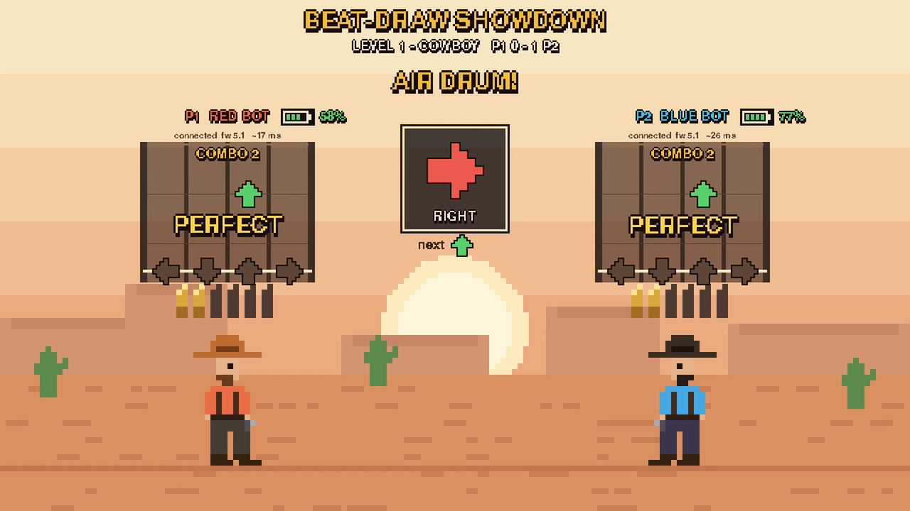
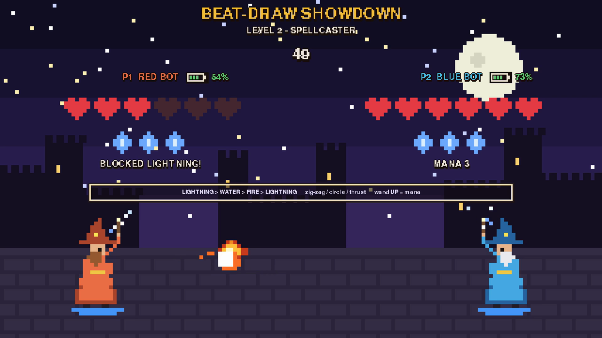
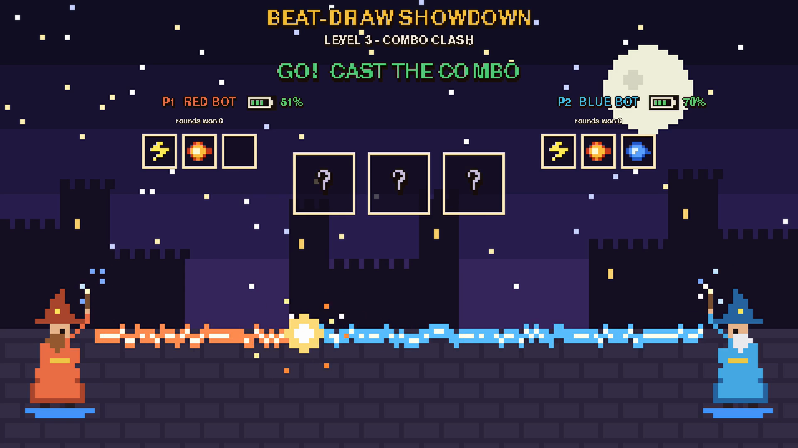

# Beat-Draw Showdown

A 2-player motion-wand duel built on **TinyCircuits** hardware for ICT1011 (Computer Organisation and Architecture) at the Singapore Institute of Technology, by **Team P1C**.

Each player holds a 3D-printed wand with a TinyScreen+, an accelerometer and a Bluetooth board inside. The wands sense and judge every move. The laptop is the referee and big screen.

| Level 1: QuickDraw | Level 2: Spellcaster | Level 3: Combo Clash |
|---|---|---|
|  |  |  |
| Hit the falling arrows on the beat to load bullets, then holster, freeze and draw. Fastest draw wins. | Charge mana by pointing the wand at the sky, then cast Fire, Water or Lightning. | Memorise a spell combo and cast it back fastest to push the beam into your opponent. |

## How it works

```
 Wand 1 ─┐                         ┌──────────────────────────┐
         ├── Bluetooth Low Energy ─┤ Laptop (Python + pygame) │
 Wand 2 ─┘   (≤ 20-byte messages)  └──────────────────────────┘
```

* **Inside each wand:** TinyScreen+ (SAMD21 ARM Cortex-M0+, OLED, 4 buttons), Accelerometer TinyShield (BMA250, over I²C), BLE TinyShield (over SPI) and a 150 mAh LiPo battery.
* **The wand** reads the accelerometer every 2 ms (500 Hz), recognises gestures and times reactions with its own microsecond clock. Then it sends a short result, e.g. `T231120` = drew in 231 ms.
* **The laptop** runs the game flow, scoring, graphics, music and announcer, and tells the wands what to do next, e.g. `G` = DRAW!
* **Why split it this way?** Bluetooth delay is about 20 ms and it varies. Timing on the wand means that delay never decides who wins.
* **Gestures:** flick = arrow (the axis and sign of the spike give the direction), thrust = Fire, circle = Water, zig-zag = Lightning, wand pointing up = mana charge.
* **Reliability:** a 2 s hardware watchdog, pause and resume when a wand disconnects, and a live battery % read through the ADC.

## Repository layout

| Folder | What's in it |
|---|---|
| `firmware/BeatDrawBlaster/` | Arduino sketch for the wand (`config.h` sets the player number and tuning) |
| `pc/` | The laptop game: `arena_referee.py` (main game), `menu.py`, `game_logic.py`, `links.py` (Bluetooth), `sounds.py`, `pixel_art.py`, `announcer.py`, `bench.py` (measurements), `tests/` |
| `3d_model/` | Wand case: STL files, OpenSCAD source, blueprint, print guide |
| `docs/` | Design notes (rules, Bluetooth protocol, timing, gesture detection), parts list, 3D-printing plan, test log, code attribution |

## Getting started

### 1. Flash the wands

1. Open `firmware/BeatDrawBlaster/BeatDrawBlaster.ino` in the Arduino IDE.
2. Set `PLAYER_ID` in `config.h` to `1`, choose the board **TinyScreen+** and upload.
3. Repeat for the second wand with `PLAYER_ID 2`.

To test a wand on its own (USB unplugged, lobby screen):

* upper-left button: cowboy practice round
* upper-right button: spell practice
* lower-left button: combo practice
* lower-right button: accelerometer debug in the Serial Monitor

### 2. Run the game on the laptop (Windows, Python 3.10+)

```
cd pc
pip install -r requirements.txt
python ble_check.py BDS-1           # check a wand connects
python arena_referee.py             # main menu: PLAY, PRACTICE, HOW TO PLAY, SETTINGS ...
python arena_referee.py --level 2   # practise just one level
```

The game is controlled with the mouse, or the arrow keys + ENTER. Press **1** / **2** in the menu to type player names, and **V** to mute the announcer.

**No hardware?** Run `python arena_referee.py --sim --bot2`. You are Player 1: W A S D = arrows, F = draw / charge, Z X C = Lightning / Water / Fire.

**Announcer:** on the first start the game records its voice lines with the built-in Windows voice (takes about 20 s, once). `python announcer.py --list` shows the other voices.

### 3. Tests and measurements

```
cd pc
python -m pytest tests
python bench.py latency BDS-1       # also: gestures, battery
```

## Team P1C

Muhammad Fadil bin Salleh, Muhammad Darwisy bin Baharudin, Mohamed Zikrulhakim bin Mohd Zulfakar, Low Jia Hao Bryan, Jovin Choo Shue Jin, Shahabudeen Mohamed Sameerudeen. Every member contributed equally.

## Credits

* BLE UART code adapted from the TinyCircuits STBLE examples. Battery reading adapted from the TinyCircuits TinyScreen+ battery tutorial.
* Music and crowd sounds from Pixabay (Pixabay Content License). All other sounds and pixel art are generated in code.
* Parts of the code were written with AI help (Claude, Anthropic), reviewed by the team.

Full details are in [`docs/CODE_ATTRIBUTION.md`](docs/CODE_ATTRIBUTION.md). The full technical design is in [`docs/DESIGN.md`](docs/DESIGN.md).
